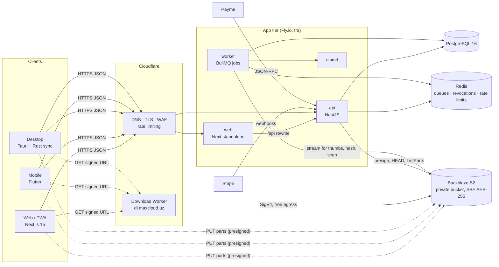
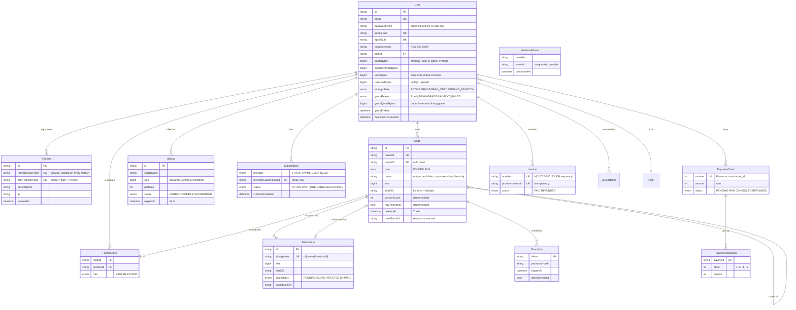
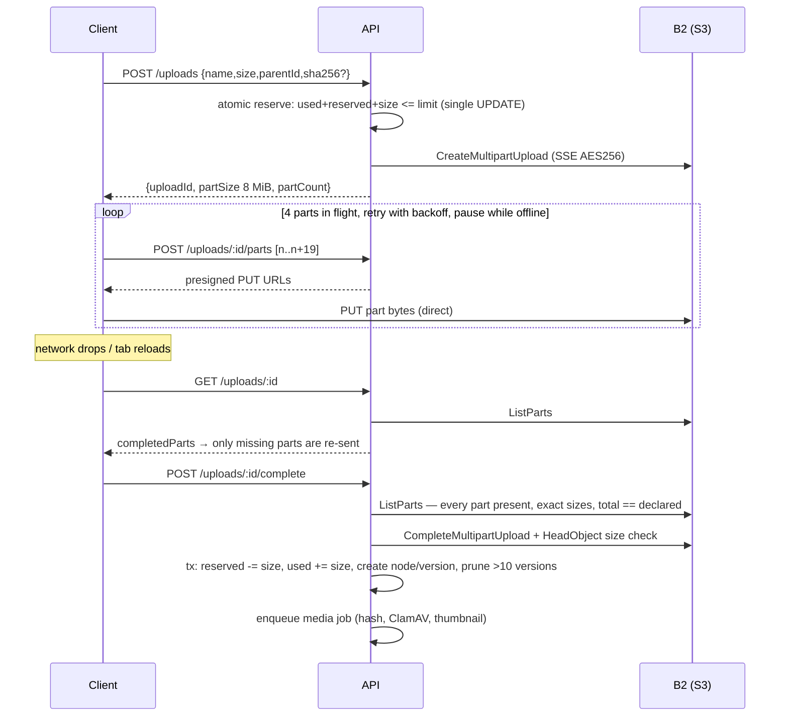
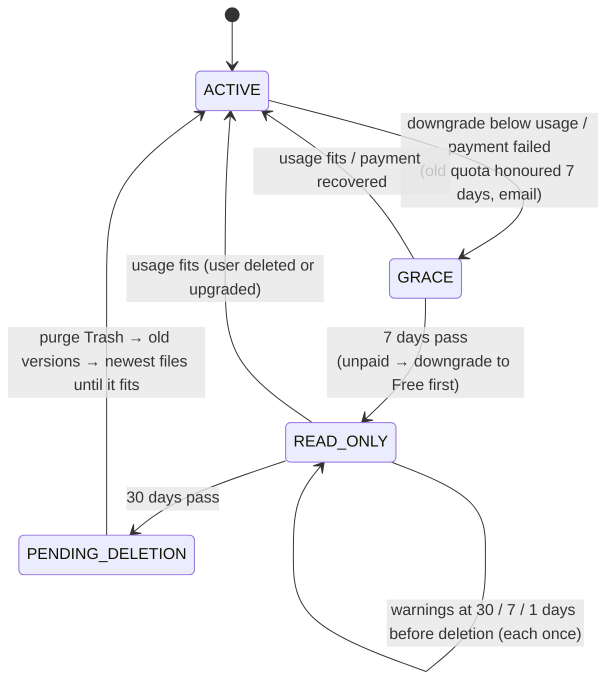
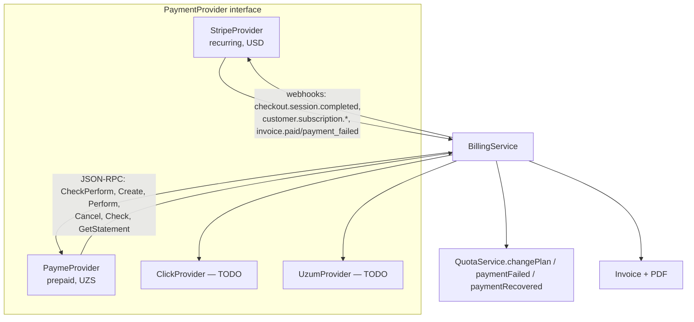

# MaxCloud — architecture

Consumer cloud storage for Uzbekistan (phones and PCs), sold in USD and UZS. 5 GB free, 50 GB → 1 TB paid.
This document covers the system design, data model, key flows, the decisions that cost money, and what's
deliberately left out of the MVP.

- API spec: [`openapi.json`](./openapi.json) (OpenAPI 3.1, generated from the same zod schemas the API validates
  with; `test/openapi.int.test.ts` fails the build if a route is undocumented).
- Unit economics: [`BUSINESS.md`](./BUSINESS.md) · Launch: [`LAUNCH_CHECKLIST.md`](./LAUNCH_CHECKLIST.md)

## 1. System overview



**File bytes never pass through the API.** Uploads are S3 multipart uploads with presigned part URLs; downloads
are short-lived URLs served by a Cloudflare Worker that reads the private B2 bucket (B2→Cloudflare egress is free
under the Bandwidth Alliance). The API only signs, verifies and does the bookkeeping.

### Why NestJS (Node) rather than Go
- **Prisma was a requirement**, and Prisma is TypeScript-native. A Go backend would mean a second ORM and a
  second set of models.
- **One language end to end.** `packages/shared` holds the plan catalogue, the zod request schemas and the
  unit-economics model. The API validates with them, the web app builds forms from them, and the OpenAPI spec is
  generated from them.
- **Go's main advantage doesn't apply.** Go would pay off on raw byte throughput, and this design never streams
  bytes through the app server. API instances stay small (512 MB, shared CPU).

## 2. Repository layout

```
apps/api        NestJS API + worker (same image, different entrypoint), Prisma schema/migrations, tests
apps/web        Next.js 15 App Router, Tailwind 4, shadcn/ui components, PWA, Playwright E2E
apps/mobile     Flutter app (auth, files, camera-roll backup)          — not compiled here (no Flutter SDK)
apps/desktop    Rust: sync-core (planner), sync-agent (engine + CLI), src-tauri (tray app)
packages/shared plans, zod schemas, formatting, unit-economics model + CLI
infra/          Fly.io configs, Cloudflare download Worker, ClamAV config, Postgres init
scripts/        dev-setup, Stripe catalogue setup, bucket provisioning, desktop sync smoke test
```

## 3. Data model



Indexes that Prisma can't express live in `prisma/migrations/*_custom_indexes`:
- a partial unique index on `(ownerId, COALESCE(parentId,''), lower(name))` for live nodes;
- covering partial indexes for listing (`parentId, type, name, id WHERE deletedAt IS NULL`);
- a trigram GIN index for name search;
- `CHECK (usedBytes >= 0)`, so accounting bugs fail loudly instead of going negative.

**Measured:** listing a 10,000-file folder (10 keyset pages of 1,000) takes **≈250 ms** end to end through HTTP
(`files.int.test.ts`, target < 500 ms).

## 4. Key flows

### Resumable upload (1 GB survives network loss)



- **The client is never trusted.** Wrong part sizes or a total that differs from the declared size → the upload
  is aborted, the object deleted and the reservation released (tested).
- **Abandoned uploads** are aborted every 15 minutes after 24 h, and their reservations released.
- **E2E proof:** Playwright throttles a 40 MB upload, takes the browser offline mid-transfer, brings it back, and
  checks the downloaded bytes are identical (`e2e/files.spec.ts`).

### Quota engine (pure state machine + atomic accounting)



`src/quota/quota-policy.ts` holds the rules and does no I/O; 20 unit tests cover every transition.
`quota.int.test.ts` runs the whole lifecycle end to end with real files and time travel.
`usedBytes` counts every stored version, including Trash and old versions, because those cost us money. A daily
reconcile job recomputes usage from `FileVersion` and repairs any drift (exported as a Prometheus gauge).

**Purge order (policy decision; legal must approve):** Trash → non-current versions, oldest first → current files,
newest first. Newest-first keeps the long-held data (old family photos) that hurts most to lose.

### Billing



- **Stripe** owns renewals and dunning. Every event is idempotent: a `WebhookEvent(provider, eventId)` row stops
  reprocessing, `Invoice.providerInvoiceId` is unique, and subscriptions are upserted by Stripe id. A processing
  failure returns 500 so Stripe retries (tested).
- **Stripe proration:** upgrades are charged the prorated difference immediately (`always_invoice`); downgrades
  credit the next invoice.
- **Payme** is prepaid, because Uzcard/Humo have no merchant-initiated recurring charges without a separate
  card-token agreement. We own the period, send a renewal reminder 3 days before it ends, and on lapse start the
  same 7-day payment grace.
- **Payme proration on upgrade:** unused days of the old plan become extra days on the new plan, valued at each
  plan's daily price.
- **Payme state machine:** the full Merchant API is implemented, including the 12-hour timeout (state −1,
  reason 4), refund after perform (state −2, which takes the period back) and all error codes. 9 integration tests.
- **Click and Uzum** are typed adapters behind the same interface. They throw `PROVIDER_UNAVAILABLE`, and each has
  a TODO explaining what's needed (a merchant account and the SHOP-API/checkout specs).

### Sharing & access control
- **Roles:** OWNER (a node's owner), and EDITOR or VIEWER through a `FolderShare` on the node or any ancestor
  (recursive CTE). Unknown and forbidden items both return 404, so existence never leaks.
- **Editors** upload into the *owner's* storage: bytes are billed to the folder owner. Moves can't cross owners,
  so nobody can dodge a quota by moving files.
- **Public links:** 128-bit token; optional argon2-hashed password, which unlocks a 2-hour signed cookie or an
  `X-Share-Token` header; expiry; view-only mode. Folder links can't escape their root.
- **Abuse controls:** unlocking is rate-limited per IP. Links are revoked automatically when the file is trashed
  or flagged as malware.

### Desktop sync (Rust)
`sync-core` does a three-way merge (local / remote / last-synced base) and outputs actions:
- an edit on one side is pushed or pulled;
- an edit on both sides produces a conflict copy (`name (conflicted copy from PC 2026-11-09).ext`);
- a deletion propagates only if the other side didn't change the file;
- selective sync and ignore rules apply;
- bandwidth is capped with a token bucket.

`scripts/desktop-sync-smoke.sh` runs two simulated PCs (plus a third with selective sync) against the live API.
Remote deletes go to the server Trash, so nothing is lost for 30 days.

## 5. Security
| Area | Implementation |
|---|---|
| Passwords | argon2id (19 MiB, t=2), equal timing for unknown emails |
| Sessions | 15-min JWT access + rotating refresh (sha256 stored, reuse ⇒ session revoked); revocation via Redis blacklist; device list + remote sign-out |
| Web | httpOnly SameSite=Lax cookies (never readable by JS), Origin check on cookie-authenticated writes (CSRF), helmet headers |
| 2FA | TOTP (secret AES-256-GCM encrypted, replay-blocked per code), 8 single-use recovery codes |
| OAuth | Google/Apple id_token verified against provider JWKS (iss, aud, exp); auto-link only when provider says email is verified |
| At rest | B2 SSE-B2 AES-256 per object (`S3_SSE=AES256`); R2/Wasabi encrypt by default |
| Transit | TLS everywhere (Cloudflare → Fly TLS; presigned URLs are HTTPS) |
| Downloads | short-lived signed URLs; risky types (HTML/SVG) never served inline; Worker adds `CSP: sandbox` |
| Malware | ClamAV INSTREAM on every upload; infected ⇒ downloads blocked, public links revoked |
| Rate limits | Redis fixed window per IP and route (login 10/min, register 5/h, link unlock 10/min, …) |
| Audit | admin quota overrides and abuse actions logged with actor + reason |

The optional end-to-end encrypted "Vault" folder isn't in this MVP. Proposed design: the client derives a key
with Argon2id from a vault passphrase, files are AES-256-GCM encrypted in 8 MiB chunks before upload, and the
server stores ciphertext only (no thumbnails, no search, no virus scan for the Vault). It needs client work on
all three apps, so it's scheduled after launch.

## 6. Cost decisions (with numbers)

### Storage provider: Backblaze B2 by default
| Provider | Price / TB-month | Egress | Minimums | Launch-scenario gross margin* |
|---|---|---|---|---|
| **Backblaze B2** | **$6.95** (PAYG since 2026-05-01; API calls free) | free to Cloudflare; else free up to 3× stored, then $0.01/GB | none | **64.8 %** |
| Wasabi | $6.99 | "free" within fair use (≤ stored volume) | **1 TB minimum, 90-day minimum retention** (deleting Trash after 30 days still pays 90) | 64.6 % |
| Cloudflare R2 | $15.36 ($0.015/GB) | free | none | **28.9 %** |

\*From `packages/shared/src/economics.ts`: ~3,200 paying users, 20,000 free users, 70% Payme / 10% Click /
20% Stripe. Wasabi's 90-day retention makes our 30-day Trash and version pruning more expensive than the table
shows. R2's only advantage, zero egress, is already free with B2 behind Cloudflare.

### Egress through Cloudflare
- B2 → Cloudflare is free under the Bandwidth Alliance, so downloads go through `dl.maxcloud.uz` (the Worker).
- **Risk:** Cloudflare's terms discourage using the CDN mainly to serve large non-web files. Because the Worker
  streams (it doesn't cache) to authenticated users, this is a Workers use case, which the terms permit.
- **Fallback if Cloudflare objects:** set `DOWNLOAD_MODE=presigned` to serve straight from B2. B2 includes free
  egress up to 3× the data stored per month, far above consumer download patterns, which typically run
  5–15% of stored data per month.
- Workers Paid costs $5/month for 10M requests.

### Infrastructure (launch size; Fly prices approximate — verify in the Fly dashboard)
| Component | Size | ≈ $/month |
|---|---|---|
| api ×2 | shared-cpu-1x, 512 MB | ~$7 |
| web ×2 | shared-cpu-1x, 512 MB | ~$7 |
| worker ×1 | shared-cpu-2x, 1 GB | ~$12 |
| clamd ×1 | shared-cpu-1x, 2 GB (signature DB is ~1.2 GB RAM) | ~$12 |
| Postgres | managed, 2 vCPU / 4 GB, daily backups + PITR | ~$40–70 |
| Redis | managed (Upstash/Fly), 256 MB | ~$10 |
| Cloudflare | Pro plan (WAF rules) + Workers Paid | $25 + $5 |
| Sentry | Team | $26 |
| **Total fixed** | | **≈ $145–175** |

At ~$1.00 contribution per paying user per month (65% of $1.57 ARPU), **break-even is roughly 150–180 paying
users**. Fixed costs grow slowly: the API is stateless and cheap because it never touches file bytes.

## 7. Data residency (decision required before launch)
**This is a launch blocker.** Uzbekistan's Law on Personal Data (ZRU-547, art. 27-1, in force since 2021) requires
personal data of Uzbek citizens processed with IT to be stored on servers physically in Uzbekistan. Fly.io has
no region there, and B2's regions are in the US and EU. Options:

1. **In-country everything (most conservative):** run the same containers (`docker compose --profile full`) on
   a VPS/colocation in a Tashkent data center. Use a self-hosted S3 store on replicated disks (Ceph RGW, or
   Garage/VersityGW on ZFS mirrors). The app needs **no code changes** (`STORAGE_PROVIDER=local`,
   `DOWNLOAD_MODE=presigned`). Hardware with 2× replication typically costs $8–15/TB-month.
   - Re-run `computeEconomics` with your quote: the model shows the 1 TB tier needs ≤ ~$8/TB to stay under the
     60% alert at 45% utilization.
2. **Hybrid:** account/billing DB in Uzbekistan, file contents in B2 EU. This only works if your lawyer confirms
   that user-uploaded file contents fall outside the "databases of personal data" requirement. This is unsettled;
   get it in writing.
3. **Foreign entity serving non-UZ markets first**, adding an in-country stack later.

The privacy policy draft deliberately says nothing about where data lives until this is decided.

## 8. Observability
- **Logs:** structured pino JSON, with request ids, auth headers and cookies redacted.
- **Errors:** Sentry for the API and worker (via `SENTRY_DSN`).
- **Metrics:** Prometheus at `/metrics` (block it at the edge) — HTTP latency histogram, uploads, bytes, quota
  rejections, webhook outcomes, usage drift, Node defaults.
- **Health:** `/health` (liveness) and `/health/ready` (DB + Redis + storage). Point the uptime monitor and the
  public status page (Better Stack / Upptime at status.maxcloud.uz) at `/health/ready`.

## 9. Testing
| Suite | What | Count |
|---|---|---|
| `packages/shared` | plans, unit economics | 8 |
| API unit | quota policy, download-signature compatibility | 21 |
| API integration (real Postgres, Redis, S3) | auth, uploads, quota hard stop + race, lifecycle, sharing, media/ClamAV, Stripe webhooks, Payme RPC, admin, worker DI, OpenAPI coverage | 66 |
| Web E2E (Playwright) | upload/download/share, **resume after network loss**, folders/move/search, demo account, mobile viewport | 8 |
| Desktop (Rust) | sync planner, limiter, tree rebuild | 15 |
| Desktop smoke | two PCs + selective sync through the live API | script |

The test database isn't wiped between runs; Prisma refuses AI-initiated `migrate reset`. Tests isolate data with
unique users and ids, so the suite is repeatable.
